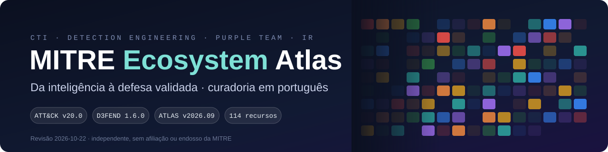
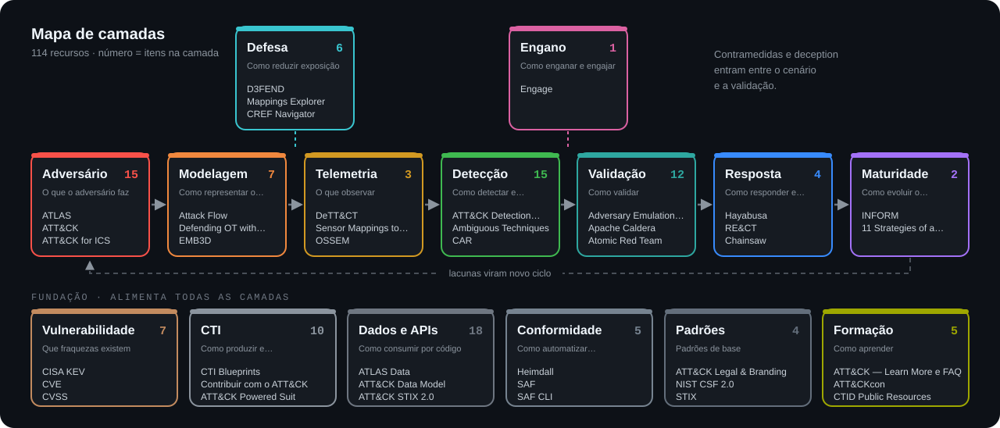
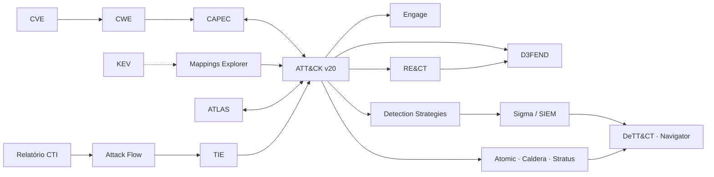

<div align="center">



[](https://attack.mitre.org/)
[](https://d3fend.mitre.org/)
[](https://atlas.mitre.org/)
[](scripts/)
[](docs/historico-e-manutencao.md)
[](#)

**Mapa curado do ecossistema MITRE, do CTID e dos projetos da comunidade que o colocam em operação.**
CTI · Threat Modeling · Detection Engineering · Adversary Emulation · Incident Response

[🔭 **Explorador interativo**](index.html) · [🗺️ Catálogo](docs/catalogo.md) · [🆕 Novidades v20](docs/novidades-2026.md) · [🔗 Crosswalks](docs/crosswalks.md) · [🧗 Trilha](docs/trilha.md)

</div>

<!-- stats:start -->
| 📦 Entradas | 🟦 MITRE | 🟩 CTID | 🟨🟧 Comunidade e fornecedores | 🔗 Relações | 🧱 Camadas | ✅ Ativos | 🗄️ Históricos |
|:-:|:-:|:-:|:-:|:-:|:-:|:-:|:-:|
| **126** | 51 | 27 | 32 | 260 | 15 | 84 | 21 |
<!-- stats:end -->
 
---

## 🆕 Expansão da curadoria — 23/10/2026

[**12 novas referências para validação, telemetria e resposta**](docs/novas-referencias-2026-10-23.md): Dettectinator, OpenAEV, Threatest, TTPForge, datasets e pesquisa aplicada. Novas no catálogo; nem todas são lançamentos recentes.

## ⚡ Comece em 3 ações

| # | Faça | Leva |
|:-:|---|:-:|
| 1 | Abra o [**explorador**](index.html) e filtre pela camada que você trabalha hoje | 2 min |
| 2 | Leia o [**resumo da v20**](docs/novidades-2026.md): Defense Evasion virou duas táticas e 17 técnicas saíram | 5 min |
| 3 | Rode o diff contra as suas regras: `python3 scripts/attack_diff.py 18.1 20.0 --rules <pasta>` | 3 min |

> O explorador funciona abrindo `index.html` direto do clone, sem servidor. Com o GitHub Pages ativado, fica em `https://ridd1kulusc0d3r.github.io/mitre/`.

---

## 🧱 Uma pergunta para cada camada



| Camada | Pergunta | Comece por |
|---|---|---|
| 🎯 [Adversário](docs/catalogo.md#adversario) | O que o adversário faz? | ATT&CK v20 · ATLAS (IA) · ATT&CK ICS · F3 (fraude) · EMB3D/ESTM |
| 🧭 [Modelagem](docs/catalogo.md#modelagem) | Como representar o cenário? | Attack Flow v4.1 · Threat Modeling with ATT&CK · Top ATT&CK Techniques |
| 📡 [Telemetria](docs/catalogo.md#telemetria) | O que precisamos observar? | Sensor Mappings · DeTT&CT · OSSEM |
| 🔎 [Detecção](docs/catalogo.md#deteccao) | Como detectar e avaliar a qualidade? | Detection Strategies · Sigma + pySigma · Summiting the Pyramid |
| 🛡️ [Defesa](docs/catalogo.md#defesa) | Como reduzir exposição e efeito? | D3FEND · Mappings Explorer |
| 🎭 [Engano](docs/catalogo.md#engano) | Como planejar deception? | Engage |
| 🧪 [Validação](docs/catalogo.md#validacao) | Como validar a capacidade? | Atomic Red Team · Apache Caldera · Stratus Red Team |
| 🚑 [Resposta](docs/catalogo.md#resposta) | Como responder e investigar? | RE&CT · NIST SP 800-61r3 · Hayabusa |
| 📈 [Maturidade](docs/catalogo.md#maturidade) | Como evoluir o programa? | INFORM · 11 Strategies |
| 🩹 [Vulnerabilidade](docs/catalogo.md#vulnerabilidade) | Que fraquezas existem? | CVE · CWE · KEV · EPSS |
| 🕵️ [CTI](docs/catalogo.md#cti) | Como produzir e compartilhar inteligência? | OpenCTI · MISP Galaxy · TIE · Decider |
| 🗄️ [Dados](docs/catalogo.md#dados) | Como consumir por código? | attack-stix-data · mitreattack-python · Navigator |

**Prioridade para um SOC:** ATT&CK → cenário → telemetria → analítica → teste → resposta. A matriz comunica evidência; pintá-la não comprova cobertura.

---

## 🆕 O que mudou em 2026

| | Mudança | Ação |
|:-:|---|---|
| 🔴 | **v19:** Defense Evasion dividida em **TA0005 Stealth** e **TA0112 Defense Impairment**; T1562 revogada → T1685/T1686 | migrar regras com o [TSV de substituições](crosswalks/attack-v18.1-v20.0-substituicoes.tsv) |
| 🟠 | **v20:** prompt injection (T1698/T1699), exfiltração com IA (T1700), anti-CAPTCHA (T1696) | abrir backlog: são lacunas por definição |
| 🟡 | **v18:** Data Sources substituídos por Detection Strategies → Analytics → Data Components | atualizar parsers e o DeTT&CT |
| 🟢 | **Caldera** virou **Apache Caldera (Incubating)** | acompanhar `apache/caldera` |
| 🔵 | D3FEND 1.6.0 e CAPEC 3.9 ainda citam técnicas revogadas | cruzar com `d3fend_xwalk.py` / `capec_xwalk.py --stale-only` |

Detalhes e números conferidos no bundle oficial: [docs/novidades-2026.md](docs/novidades-2026.md).

---

## 🔗 Como tudo se conecta



Leia as [cinco cadeias de crosswalk](docs/crosswalks.md) e use os arquivos prontos em [`crosswalks/`](crosswalks/) e [`layers/`](layers/).

---

## 🛠️ Scripts (Python stdlib + shell)

| Script | Para quê |
|---|---|
| [`fetch_all.sh`](scripts/fetch_all.sh) | baixa ATT&CK, CAPEC e ATLAS em versões fixas, com SHA-256 |
| [`attack_diff.py`](scripts/attack_diff.py) | o que mudou entre versões e quais regras suas quebraram |
| [`attack_dump.py`](scripts/attack_dump.py) | técnicas por tática com CAPEC e Detection Strategies |
| [`coverage_layer.py`](scripts/coverage_layer.py) | camada do Navigator a partir de Sigma, Atomic ou regras próprias |
| [`capec_xwalk.py`](scripts/capec_xwalk.py) · [`d3fend_xwalk.py`](scripts/d3fend_xwalk.py) | crosswalks com alerta de técnica revogada |
| [`jq-receitas.sh`](scripts/jq-receitas.sh) | consultas prontas: táticas, grupos, revogadas, IA |
| [`check_repos.py`](scripts/check_repos.py) | atualiza sinais de manutenção pela API do GitHub |
| [`build_catalog.py`](scripts/build_catalog.py) | valida o JSON e regenera catálogo, CSV, SVGs e explorador |

```bash
git clone https://github.com/Ridd1kulusC0d3r/mitre && cd mitre
./scripts/fetch_all.sh
python3 scripts/attack_diff.py 18.1 20.0 --rules ~/minhas-regras
./scripts/jq-receitas.sh impairment
```

Mais receitas e endpoints: [docs/dados-e-apis.md](docs/dados-e-apis.md).

---

## 🧗 Trilhas

| Trilha | Sequência | Entrega final |
|---|---|---|
| **8 semanas (guiada)** | [uma ação por vez](docs/trilha.md), com progresso salvo no [explorador](index.html#trilha) | do Navigator ao plano INFORM |
| CTI | ATT&CK → CTI Blueprints → Attack Flow → TIE → OpenCTI | relatório com evidências e relações |
| Detecção | Sensor Mappings → DeTT&CT → Sigma → Summiting → Atomic/Caldera | caso de detecção testado |
| Threat modeling | ativos e fluxos → Threat Modeling with ATT&CK → D3FEND → Mappings Explorer | cenário e controles justificáveis |
| Resposta e forense | cenário → RE&CT → NIST 800-61r3 → Hayabusa/Chainsaw → exercício | playbook com responsáveis |
| OT e embarcados | ATT&CK ICS → Defending OT → EMB3D/ESTM → D3FEND (ICS) | cenário com restrições operacionais |
| IA | ATLAS → Secure AI → T1698/T1699 → validação | caso de abuso e evidência de mitigação |
| Fraude (BR) | F3 → ATT&CK Mobile → T1684/T1696 → antifraude | [caso 5](examples/casos-guiados.md#caso-5--fraude-via-pix-e-mobile-banking) |
| Contribuir com o ATT&CK | procedimento observado → evidência → Attack Flow → [formulário de contribuição](https://attack.mitre.org/resources/engage-with-attack/contribute/) | crédito como contribuidor na técnica |
| ATT&CK interno | [Workbench Deployment](https://github.com/mitre-attack/attack-workbench-deployment) → extensões da casa → TAXII interno | base com grupos BR/LATAM do time |

---

## 📚 Tudo no repositório

| Quero… | Abra |
|---|---|
| Buscar e filtrar recursos | [Explorador](index.html) · [Catálogo](docs/catalogo.md) · [CSV](data/ecosystem.csv) · [JSON](data/ecosystem.json) |
| Entender o fluxo de trabalho | [Guia operacional](docs/guia-operacional.md) |
| Ver casos de ponta a ponta | [Cinco casos](examples/casos-guiados.md) (o 4 foi executado com dados reais) |
| Registrar um caso com rastreabilidade | [Template](templates/caso-operacional.md) |
| Saber o que foi depreciado | [Histórico e manutenção](docs/historico-e-manutencao.md) |
| Contribuir | [CONTRIBUTING](CONTRIBUTING.md) |

<details>
<summary><b>Estrutura de pastas</b></summary>

```text
.
├── index.html                 explorador interativo (abre offline)
├── assets/                    banner, mapa de camadas, dados do explorador (gerados)
├── data/
│   ├── ecosystem.json         FONTE ÚNICA do catálogo (schema 2.0)
│   ├── ecosystem.csv          gerado
│   └── trilha.json            trilha de 8 semanas
├── docs/                      catálogo (gerado), novidades, crosswalks, dados, guia, trilha, histórico
├── crosswalks/                TSVs gerados por script (v18→v20, CWE→CAPEC→ATT&CK)
├── layers/                    camadas Navigator de exemplo (Sigma, Atomic, Sigma × Atomic)
├── examples/ · templates/     casos guiados e template de caso
├── scripts/                   Python stdlib + shell
└── .github/workflows/         validação a cada push e monitor mensal
```
</details>

---

## ⚠️ Nomes que precisam de cuidado

- **D3FEND** é da MITRE; **DeTT&CT** é do Rabobank; **RE&CT** é do ATC Project.
- **Respond** é uma função do NIST CSF. Não existe um "MITRE RESPOND" oficial.
- **FiGHT** trata de 5G; **Fight Fraud Framework (F3)** trata de fraude financeira.
- **SPARTA** é da Aerospace Corporation e **DISARM** da DISARM Foundation, não da MITRE.
- **Caldera** hoje é governado pela Apache Software Foundation.
- **STIX/TAXII** são padrões OASIS; **CVSS/EPSS**, FIRST.
- **CVE, CWE, CAPEC e ATT&CK** descrevem objetos diferentes. Mapeamento exige contexto e evidência.

## 🔍 Escopo e qualidade

Base de referência **documental**, revisada em **22/10/2026**. Versões do ATT&CK, D3FEND, ATLAS e das principais ferramentas foram conferidas na fonte (bundle STIX, changelog, tag Git ou PyPI); o restante vem de pesquisa web e está marcado como tal no JSON. As ferramentas de terceiros não foram executadas nem certificadas. "Top" significa utilidade para o fluxo descrito, não contagem de estrelas.

Veja [fontes, sinais de manutenção e limitações](docs/historico-e-manutencao.md). Marcas, dados e ferramentas pertencem aos respectivos titulares; cada fonte tem seus próprios termos.

<div align="center"><sub>Curadoria independente por <a href="https://github.com/Ridd1kulusC0d3r">Deivison Lourenço · Ridd1kulusC0d3r</a>. Sem afiliação ou endosso da MITRE.</sub></div>

