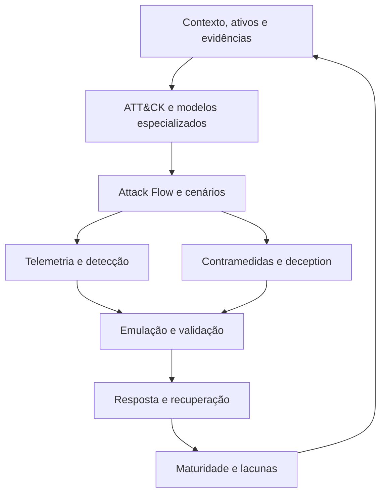

# MITRE · ECOSYSTEM ATLAS

**Da inteligência à defesa validada.**

CTI · Threat Modeling · Detection Engineering · Adversary Emulation · Incident Response

**75 recursos mapeados** · **7 repositórios históricos** · **3 casos guiados**

Curadoria independente em português por [Deivin / Ridd1kulusC0d3r](https://github.com/Ridd1kulusC0d3r).
Sem afiliação ou endosso da MITRE.

---

## Explore o mapa

| Quero… | Comece aqui |
|---|---|
| Encontrar frameworks, ferramentas e fontes | [Catálogo por finalidade](docs/catalogo.md) |
| Entender como conectar os projetos | [Guia operacional](docs/guia-operacional.md) |
| Transformar teoria em entregas | [Três casos guiados](examples/casos-guiados.md) |
| Registrar um caso com rastreabilidade | [Template de caso](templates/caso-operacional.md) |
| Consumir o inventário com scripts ou IA | [Catálogo JSON](data/ecosystem.json) |
| Identificar legados e manter a curadoria | [Histórico e manutenção](docs/historico-e-manutencao.md) |
| Adicionar uma referência | [Critérios de contribuição](CONTRIBUTING.md) |

## Uma pergunta para cada camada

| Pergunta | Recursos de partida |
|---|---|
| O que o adversário faz? | ATT&CK; ATLAS para IA; EMB3D/ESTM para embarcados; FiGHT para 5G |
| Como representar o cenário? | Attack Flow + Threat Modeling with ATT&CK |
| O que precisamos observar? | Sensor Mappings + DeTT&CT |
| Como detectar e avaliar a qualidade? | ATT&CK Detection Strategies/Analytics + CAR + Sigma + Summiting the Pyramid |
| Como reduzir exposição e efeito? | D3FEND + Mappings Explorer + SAF |
| Como validar a capacidade? | Atomic Red Team + CALDERA + Adversary Emulation Library |
| Como responder e aprender? | RE&CT + NIST SP 800-61r3 + INFORM |
| Como planejar deception? | Engage |

**Prioridade para um SOC:** ATT&CK → contexto do cenário → telemetria → analítica → teste → resposta. A matriz vem para comunicar evidência; preenchê-la de cores não comprova cobertura.

## Arquitetura de uso

Diagrama editorial deste repositório: representa relações de trabalho, não integrações automáticas entre produtos.

## Nomes que precisam de cuidado

- **D3FEND** é da MITRE; **DeTT&CT** é Rabobank/comunidade; **RE&CT** é ATC Project.
- **Respond** é uma função do NIST CSF. Não atribuímos um “MITRE RESPOND” sem fonte oficial.
- **FiGHT** trata de 5G; **Fight Fraud Framework** trata de fraude financeira.
- **STIX/TAXII** são padrões OASIS; **CVSS/EPSS**, FIRST.
- **CVE, CWE, CAPEC e ATT&CK** descrevem objetos diferentes. Mapeamento exige contexto e evidência.

## Escolha sua trilha

| Trilha | Sequência sugerida | Entrega final |
|---|---|---|
| CTI | ATT&CK → CTI Blueprints → Attack Flow → Workbench/OpenCTI | Relatório com evidências e relações |
| Engenharia de detecção | Sensor Mappings → DeTT&CT → CAR/Sigma → Summiting → Atomic/CALDERA | Caso de detecção testado |
| Threat modeling | Ativos e fluxos → Threat Modeling with ATT&CK → D3FEND → Mappings Explorer | Cenário e controles justificáveis |
| Resposta | Cenário → RE&CT → NIST 800-61r3 → exercício de mesa | Playbook com responsáveis e critérios |
| OT e embarcados | ATT&CK ICS → Defending OT → EMB3D/ESTM | Cenário com restrições operacionais |
| IA | ATLAS → contexto do sistema → controles → validação | Caso de abuso e evidência de mitigação |
| Maturidade | INFORM → lacunas → iniciativas → reavaliação | Plano de evolução mensurável |

## Escopo e qualidade

Esta é uma base de referência **documental**, revisada em **23/10/2026**. A pesquisa consultou fontes primárias e metadados GitHub; não executou nem certificou os projetos. As 75 entradas incluem publicações e padrões, além de ferramentas. A seção histórica mantém sete repositórios arquivados fora da seleção principal.

Não há promessa de exaustividade de toda a MITRE. O foco é seu ecossistema de cibersegurança e projetos externos que ajudam a operacionalizá-lo. “Top” significa utilidade para o fluxo de trabalho descrito, não contagem de estrelas.

Veja [fontes, sinais de manutenção e limitações](docs/historico-e-manutencao.md). Marcas, dados e ferramentas pertencem aos respectivos titulares; cada fonte possui seus próprios termos.
