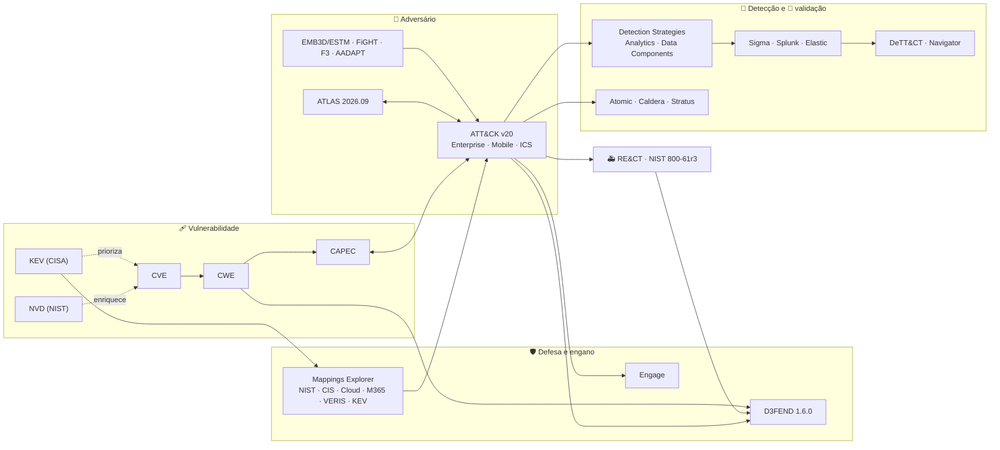

# 🔗 Crosswalks: como os frameworks se ligam

[← Início](../README.md) · [Catálogo](catalogo.md) · [Dados e APIs](dados-e-apis.md)

Um crosswalk é uma tabela que liga IDs de dois frameworks. Ele indica **onde investigar**, nunca prova que um controle bloqueia ou que uma regra detecta. Cada ligação abaixo tem dono, versão e data, e qualquer uma pode estar desatualizada.

## Mapa geral



## As cinco cadeias úteis

### 1. Vulnerabilidade → comportamento → defesa

`CVE → CWE → CAPEC → ATT&CK → D3FEND / Engage`

| Ligação | Onde está no dado | Arquivo neste repo |
|---|---|---|
| CVE → CWE | `problemTypes` no registro CVE 5.x; enriquecimento da NVD | — |
| CWE → CAPEC | `external_references` com `source_name: cwe` no STIX do CAPEC | [`cwe-capec-attack.tsv`](../crosswalks/cwe-capec-attack.tsv) |
| CAPEC → ATT&CK | `external_references` com `source_name: ATTACK` | idem (271 linhas, 15 obsoletas na v20) |
| ATT&CK → D3FEND | `d3fend-full-mappings.json` | gere com `scripts/d3fend_xwalk.py` |
| CVE → ATT&CK direto | Mappings Explorer (KEV) | baixar do Mappings Explorer |

```bash
python3 scripts/capec_xwalk.py --cwe CWE-287          # autenticação imprópria
python3 scripts/capec_xwalk.py --stale-only           # mapeamentos para técnicas revogadas
python3 scripts/d3fend_xwalk.py T1685 --check-revoked
```

### 2. Detecção

`ATT&CK técnica → Detection Strategy → Analytic → Data Component → regra (Sigma/SPL/KQL) → teste (Atomic) → cobertura (DeTT&CT/Navigator) → robustez (Summiting)`

```bash
python3 scripts/coverage_layer.py sigma/rules --name Sigma -o sigma.json
python3 scripts/coverage_layer.py atomic-red-team/atomics --mode dirs --name Atomic -o atomic.json
python3 scripts/coverage_layer.py --merge sigma.json atomic.json -o lacunas.json
```

Exemplos gerados em 22/10/2026 estão em [`layers/`](../layers): Sigma cita 407 técnicas, Atomic tem testes para 346, e 277 aparecem nos dois. Abra no [Navigator](https://mitre-attack.github.io/attack-navigator/) com *Open Existing Layer → Upload from local*.

### 3. Resposta

`ATT&CK → RE&CT (Response Actions) → D3FEND (Isolate · Evict · Restore) → Engage`

RE&CT tem pouca atividade desde 2022: use a taxonomia de ações, mas revise cada playbook contra o NIST SP 800-61r3 e o seu ambiente.

### 4. CTI

`relatório → TRAM / Decider → Attack Flow → TIE → Top ATT&CK Techniques → OpenCTI / MISP`

### 5. Domínios especiais

| Ligação | Observação |
|---|---|
| ATLAS ↔ ATT&CK | prompt injection existe nos dois desde a v20 (AML.T0051 · T1698/T1699) |
| ATT&CK ICS ↔ D3FEND | mapeamentos T0800–T0895 desde a D3FEND 1.5.0 |
| SPARTA ↔ D3FEND | SPARTA v4.0 desde a D3FEND 1.6.0 (SPARTA não é MITRE) |
| F3 / AADAPT ↔ ATT&CK | técnicas adaptadas; úteis para fraude e cripto |
| DISARM ↔ RE&CT | ações de resposta a desinformação |

## Migração entre versões do ATT&CK

[`attack-v18.1-v20.0-substituicoes.tsv`](../crosswalks/attack-v18.1-v20.0-substituicoes.tsv) lista as 17 técnicas que saíram e a substituta que o próprio ATT&CK declara (relação `revoked-by`). Para outro par de versões:

```bash
python3 scripts/attack_diff.py 17.1 20.0 > diff.md
python3 scripts/attack_diff.py 18.1 20.0 --rules regras/   # quais regras suas precisam mudar
```

## Regras para usar um crosswalk sem se enganar

1. Fixe as versões dos dois lados e grave-as junto com o resultado.
2. Desconfie de mapeamentos para IDs revogados: siga o `revoked-by`.
3. Um-para-muitos é normal; escolha pelo procedimento observado, não pelo ID mais genérico.
4. Ligação ontológica (D3FEND) e cobertura de artefatos (Sigma/Atomic) não comprovam eficácia.
5. Regere os TSVs a cada release; não edite à mão.
