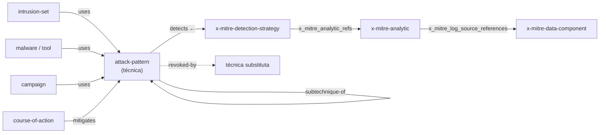

# 🗄️ Dados e APIs: consumir o ecossistema por código

[← Início](../README.md) · [Crosswalks](crosswalks.md) · [Novidades](novidades-2026.md)

Tudo aqui funciona com **Python só com stdlib** (`urllib`, `json`, `csv`) e **shell** (`curl`, `jq`). URLs conferidas em 22/10/2026.

## Fontes oficiais

| Fonte | URL | Formato | Conferido |
|---|---|---|:-:|
| ATT&CK, versão fixa | `https://raw.githubusercontent.com/mitre-attack/attack-stix-data/master/enterprise-attack/enterprise-attack-20.0.json` (também `mobile-attack`, `ics-attack`) | STIX 2.1 | ✔ |
| ATT&CK, índice de coleções | `https://raw.githubusercontent.com/mitre-attack/attack-stix-data/master/index.json` | JSON | ✔ |
| ATT&CK STIX 2.0 por tag | `https://raw.githubusercontent.com/mitre/cti/ATT%26CK-v20.0/enterprise-attack/enterprise-attack.json` | STIX 2.0 | — |
| ATT&CK TAXII 2.1 | `https://attack-taxii.mitre.org/` | TAXII 2.1 | — |
| Changelog legível por máquina | `https://attack.mitre.org/docs/changelogs/v19.2-v20.0/changelog.json` | JSON | — |
| CAPEC em STIX | `https://raw.githubusercontent.com/mitre/cti/master/capec/2.1/stix-capec.json` (CAPEC 3.9) | STIX 2.1 | ✔ |
| CAPEC / CWE em XML | `https://capec.mitre.org/data/xml/capec_latest.xml` · `https://cwe.mitre.org/data/xml/cwec_latest.xml.zip` | XML | — |
| ATLAS | `https://raw.githubusercontent.com/mitre-atlas/atlas-data/main/dist/v6/ATLAS-2026.09.yaml` | YAML | ✔ |
| D3FEND mapeamentos | `https://d3fend.mitre.org/ontologies/d3fend/1.6.0/d3fend-full-mappings.json` | JSON (SPARQL) | — |
| D3FEND ontologia | `https://d3fend.mitre.org/ontologies/d3fend.owl` (também `.ttl`, `.json`) | OWL/TTL/JSON-LD | — |
| CVE | `https://github.com/CVEProject/cvelistV5` | JSON 5.x | ✔ |
| KEV | `https://www.cisa.gov/known-exploited-vulnerabilities-catalog` | JSON/CSV | — |

— = não acessível do ambiente de teste desta revisão; endereço documentado pela fonte.

## Scripts deste repositório

| Script | Faz | Exemplo |
|---|---|---|
| `fetch_all.sh` | baixa versões fixas e grava SHA-256 em `data/cache/manifest.tsv` | `./scripts/fetch_all.sh` |
| `attack_dump.py` | técnicas por tática, com CAPEC e nº de Detection Strategies | `python3 scripts/attack_dump.py --domain ics` |
| `attack_diff.py` | o que mudou entre versões; cruza com suas regras | `python3 scripts/attack_diff.py 19.2 20.0 --rules regras/` |
| `capec_xwalk.py` | CWE → CAPEC → ATT&CK com status na v20 | `python3 scripts/capec_xwalk.py --stale-only` |
| `d3fend_xwalk.py` | contramedidas D3FEND por técnica, com alerta de revogação | `python3 scripts/d3fend_xwalk.py T1059.001 --check-revoked` |
| `coverage_layer.py` | camada Navigator a partir de regras ou testes | `python3 scripts/coverage_layer.py sigma/rules -o s.json` |
| `jq-receitas.sh` | consultas prontas com jq | `./scripts/jq-receitas.sh impairment` |
| `check_repos.py` | atualiza sinais de manutenção via API do GitHub | `GITHUB_TOKEN=… python3 scripts/check_repos.py` |
| `build_catalog.py` | valida o JSON e regenera catálogo, CSV e explorador | `python3 scripts/build_catalog.py` |

## Receitas mínimas

### Python stdlib: técnicas de uma tática

```python
import json, urllib.request
URL = ("https://raw.githubusercontent.com/mitre-attack/attack-stix-data/master/"
       "enterprise-attack/enterprise-attack-20.0.json")
objs = json.load(urllib.request.urlopen(URL, timeout=180))["objects"]
ativo = lambda o: not o.get("revoked") and not o.get("x_mitre_deprecated")
eid = lambda o: next(r["external_id"] for r in o["external_references"] if r["source_name"] == "mitre-attack")
for o in objs:
    if o["type"] == "attack-pattern" and ativo(o):
        if any(k["phase_name"] == "defense-impairment" for k in o.get("kill_chain_phases", [])):
            print(eid(o), o["name"])
```

### Python stdlib: Detection Strategies de uma técnica

```python
by = {o["id"]: o for o in objs}
alvo = next(o for o in objs if o["type"] == "attack-pattern" and eid(o) == "T1059.001")
for r in objs:
    if r["type"] == "relationship" and r.get("relationship_type") == "detects" and r["target_ref"] == alvo["id"]:
        ds = by[r["source_ref"]]
        print(ds["name"], [eid(by[a]) for a in ds.get("x_mitre_analytic_refs", []) if a in by])
```

### Shell: contagem e táticas

```bash
F=data/cache/enterprise-attack-20.0.json
jq '[.objects[]|select((.revoked|not) and (.x_mitre_deprecated|not))]|group_by(.type)|map({t:.[0].type,n:length})' "$F"
./scripts/jq-receitas.sh taticas
./scripts/jq-receitas.sh grupo Malteiro
```

### Shell: versão mais recente publicada

```bash
curl -s https://raw.githubusercontent.com/mitre-attack/attack-stix-data/master/index.json \
  | jq -r '.collections[]|"\(.name)\t\(.versions[0].version)\t\(.versions[0].modified[:10])"'
```

## Modelo de dados do ATT&CK desde a v18



## Boas práticas

- Baixe **versões fixas** e guarde o hash; "latest" muda sem aviso.
- Use `python3 -I` para rodar scripts sobre dados baixados (isola o diretório atual).
- Filtre sempre `revoked` e `x_mitre_deprecated`.
- Releases Agile (como a v19.2) mexem em grupos e softwares: atualize ao menos mensalmente.
