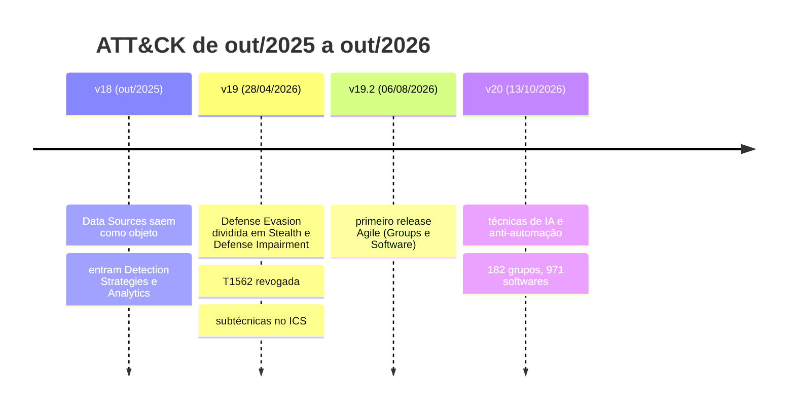

# 🆕 Novidades 2025–2026: o que mudou e o que fazer

[← Início](../README.md) · [Catálogo](catalogo.md) · [Crosswalks](crosswalks.md) · [Dados e APIs](dados-e-apis.md)

Revisão de **22/10/2026**. Itens marcados com ✔ foram conferidos diretamente nos dados ou repositórios oficiais nesta data (bundle STIX, CHANGELOG, tag Git ou PyPI). Os demais vêm de pesquisa web e anúncios oficiais.

> **Resumo para um SOC/MSSP:** se suas regras foram mapeadas antes da v19, elas estão desatualizadas na parte de evasão e tampering. Rode `python3 scripts/attack_diff.py 18.1 20.0 --rules <suas-regras>` antes de qualquer outra coisa.

---

## 1. ATT&CK: três releases que mudaram o modelo

### ✔ Números da v20.0 (contados no bundle STIX oficial)

| Domínio | Táticas | Técnicas | Subtécnicas | Detection Strategies | Analytics | Data Components | Grupos | Campanhas |
|---|:-:|:-:|:-:|:-:|:-:|:-:|:-:|:-:|
| Enterprise | 15 | 227 | 479 | 703 | 1.770 | 106 | 178 | 57 |
| Mobile | 12 | 78 | 47 | 124 | 211 | 29 | 20 | 3 |
| ICS | 12 | 78 | 26 | 106 | 302 | 36 | 14 | 10 |

Contagem de objetos ativos (sem `revoked` nem `x_mitre_deprecated`) em `attack-stix-data`, arquivos `*-attack-20.0.json`. Os totais de grupos e softwares divulgados pela MITRE somam os três domínios, por isso diferem desta tabela.

### ✔ Defense Evasion virou duas táticas

| Antes (≤ v18) | Agora (v19+) |
|---|---|
| TA0005 Defense Evasion | **TA0005 Stealth** (mantém o ID: esconder-se) |
| — | **TA0112 Defense Impairment** (novo: desligar, modificar ou burlar defesas) |

### ✔ As 17 técnicas que saíram entre v18.1 e v20.0

Arquivo pronto para automação: [`crosswalks/attack-v18.1-v20.0-substituicoes.tsv`](../crosswalks/attack-v18.1-v20.0-substituicoes.tsv).

| Saiu | Use agora |
|---|---|
| T1562 Impair Defenses · T1562.001 Disable or Modify Tools · T1562.006 Indicator Blocking | **T1685** Disable or Modify Tools |
| T1562.002 Disable Windows Event Logging | T1685.001 |
| T1562.008 Disable or Modify Cloud Logs | T1685.002 |
| T1562.011 Spoof Security Alerting | T1685.003 Modify or Spoof Tool UI |
| T1562.012 Disable or Modify Linux Audit System | T1685.004 |
| T1070.001 Clear Windows Event Logs | T1685.005 |
| T1070.002 Clear Linux or Mac System Logs | T1685.006 |
| T1562.004 Disable or Modify System Firewall | **T1686** |
| T1562.007 Disable or Modify Cloud Firewall | T1686.001 |
| T1562.013 Disable or Modify Network Device Firewall | T1686.002 |
| T1562.003 Impair Command History Logging | T1690 Prevent Command History Logging |
| T1562.009 Safe Mode Boot | T1688 |
| T1562.010 Downgrade Attack | T1689 |
| T1656 Impersonation | T1684.001 (dentro de T1684 Social Engineering) |
| T1672 Email Spoofing | T1684.002 |

Também foram **renomeadas**: T1211 (Exploitation for Defense Evasion → *for Stealth*), T1222.001, T1222.002 e T1557.001 (*Name Resolution Poisoning and SMB Relay*).

### ✔ Técnicas novas que viram lacunas por definição

| ID | Técnica | Por que importa |
|---|---|---|
| T1698 / T1699 | Indirect / Direct Prompt Injection | IA corporativa entra no escopo do Enterprise, não só do ATLAS |
| T1700 | AI-Enabled Exfiltration | exfiltração mediada por agentes |
| T1608.007 | AI Result Poisoning | envenenamento de resultados consumidos por IA |
| T1682 · T1683 | Query Public AI Services · Generate Content | uso ofensivo de IA na preparação |
| T1685.007 | Impair Autonomous Defenses | ataque a defesas automatizadas |
| T1696 | Anti-Automation Evasion (CAPTCHA) | relevante para fraude e abuso de contas |
| T1697 | Steal Application Specific Passwords | contorno de MFA |
| T1027.018 | Invisible Unicode | ofuscação em prompts e código |

### ✔ Efeito prático medido nesta revisão

- **SigmaHQ (main, 22/10/2026):** já usa T1685 em 161 regras, mas ainda havia **55 ocorrências** de IDs revogados (ex.: T1562.004, T1070.002). Migração da comunidade está em andamento.
- **CAPEC 3.9:** **15 mapeamentos** CAPEC → ATT&CK apontam para técnicas revogadas na v20 (ex.: CAPEC-268 Audit Log Manipulation → T1562.002). Veja `crosswalks/cwe-capec-attack.tsv`, coluna `attack_status`.
- **DeTT&CT 2.2.0 (21/01/2026):** suporta o modelo da v18; suporte a v19/v20 não está declarado no changelog.

---

## 2. D3FEND ✔

| Versão | Data | Destaques |
|---|---|---|
| 1.6.0 | 31/08/2026 | SPARTA v4.0; restrições materializadas para artefatos, eventos e agentes; JSON-LD determinístico |
| 1.5.0 | 31/07/2026 | ATT&CK v19.0 e ATLAS 2026.06; mapeamentos ICS T0800–T0895; relações *prescribes* |
| 1.4.0 | 31/03/2026 | modelagem espacial e SDR; ATT&CK 18.1; novas restrições cloud |

**Atenção:** o issue #709 relata que os mapeamentos da 1.6.0 ainda apontam para técnicas revogadas na v19. `scripts/d3fend_xwalk.py --check-revoked` mostra a substituta.

## 3. ATLAS ✔

- **v2026.09 (14/09/2026):** 16 táticas, 120 técnicas, 88 subtécnicas, 40 mitigações, 73 estudos de caso. Novas técnicas de agentes (ex.: AML.T0130 AI Agent Response Biasing, AML.T0133 Discover AI Agent Runtime Capabilities) e a mitigação AML.M0039 AI Honeypots.
- **Formato:** desde 2026.05, versão de conteúdo (AAAA.MM) separada da versão de formato (6.0.0). `dist/ATLAS.yaml` foi depreciado; `dist/ATLAS-latest.yaml` é um symlink, então baixe `dist/v6/ATLAS-<versão>.yaml`.

## 4. CTID em 2026

Datas dos anúncios oficiais do CTID; só o Attack Flow foi conferido por tag nesta revisão.

| Data | Projeto | O que é |
|---|---|---|
| 08/01 | INFORM | Maturidade threat-informed; substitui o M3TID |
| 27/01 | Threat-Informed Defense for Cloud Security | Controles de nuvem ↔ ATT&CK |
| fev | Ambiguous Techniques | Telemetria mínima para técnicas ambíguas |
| 09/04 | Fight Fraud Framework (F3) | Táticas de fraude financeira |
| 06/05 | Secure AI | Expansão do ATLAS com emulação |
| 30/07 · 14/10 ✔ | Attack Flow v4.0 · v4.1.0 | v4.1 com integração D3FEND |
| 10/09 | Summiting the Pyramid | Cobertura de implementação e qualidade de detecção |
| out | CIS Controls no Mappings Explorer | Controles CIS ↔ técnicas |

## 5. Governança e ferramentas

| Item | Mudança |
|---|---|
| Caldera ✔ | Doado à Apache Software Foundation: **Apache Caldera (Incubating)**, repo `apache/caldera`, tag 5.3.0 |
| mitreattack-python ✔ | 6.3.1 publicado em 13/10/2026, junto com a v20 |
| Sigma ✔ | release r2026-07-01; pySigma 2.0.1; sigma-cli 3.1.0 |
| pyattck | arquivado em 17/03/2026 (pesquisa web); último release 7.1.2 em 2023 ✔ (PyPI): migre para mitreattack-python ou attackcti |
| ATT&CK Navigator ✔ | v5.3.2 · Workbench v4.18.0-alpha.1 |
| CVE | crise de financiamento em abr/2025; contrato com a CISA prorrogado e renegociado |
| ATT&CK Evaluations | edição 2026 com a métrica TES (DQI + PQI) |
| ATT&CK Advisory Council | criado em 25/02/2026 |

---

## Checklist de migração (uma ação por vez)

- [ ] Baixar a v20 fixada: `./scripts/fetch_all.sh`
- [ ] Listar regras com IDs revogados: `python3 scripts/attack_diff.py 18.1 20.0 --rules <pasta>`
- [ ] Trocar os IDs usando o TSV de substituições
- [ ] Reclassificar regras de tampering de TA0005 para TA0112
- [ ] Abrir backlog para T1698, T1699, T1700, T1696 e T1697
- [ ] Atualizar layers do Navigator para `"attack": "20"`
- [ ] Revalidar crosswalks D3FEND e CAPEC contra a v20
- [ ] Registrar no CHANGELOG do time a data e a versão usadas
